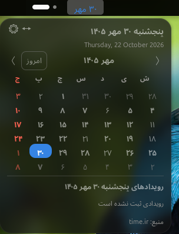

# JalaliTray4Gnome

A GNOME Shell extension that shows today's Jalali (Shamsi) date in the top bar. It is a port of [JalaliTray](https://github.com/avestura/JalaliTray) by [Avestura](https://github.com/avestura) from the Windows tray to GNOME, and all credit for the original idea and design goes to them.



Click the date to open a popup with:
- a live clock and today's Jalali, Gregorian and Hijri dates
- a Saturday-first month grid, with Fridays and holidays in red and days with events in bold
- events for the selected day from the public time.ir calendar (fetched one month at a time and cached in `~/.cache/jalali-calendar`, with bundled fixed-date holidays as an offline fallback)
- a Jalali ↔ Gregorian converter (click the result to jump to that date)

You can scroll over the grid to change months. The UI is Persian by default, with English available in settings.

## Settings
- **Top bar:** position (left, center next to the clock, or right), order within that area, label format (`۳۰`, `۳۰ مهر`, `۳۰ مهر ۱۴۰۵`, `پنجشنبه ۳۰ مهر ۱۴۰۵`, `۱۴۰۵/۰۷/۳۰`), red highlighting for Fridays and holidays, left/right padding and margin, and an optional fixed label width so the date stays put when neighbouring extensions change.
- **Display:** language, whether to show the clock in the popup, whether to show the Gregorian and Hijri dates, and a Hijri adjustment of ±2 days to match Iran's official moon sighting.
- **Clock sync (NTP):** the NTP server to use (any host name or IP address in the world) and automatic sync on start and every hour. The popup has a *Sync clock with NTP* button. Only the extension's clock and date are corrected; the system clock is never changed.
- **Events:** turn time.ir downloads on or off, and show or hide holidays, religious, national and international occasions.

## Install
Requires GNOME Shell 45–48 (Ubuntu 24.04 ships 46).

```bash
./install.sh
# Wayland: log out and back in. X11: Alt+F2, r, Enter.
gnome-extensions enable jalali-calendar@jalalitray4gnome
gnome-extensions prefs jalali-calendar@jalalitray4gnome   # settings
```

It can run alongside `shamsi-calendar@gnome.scr.ir`. Disable that one if you want only this one.

Uninstall with `./install.sh uninstall`.

Logs: `journalctl -f -o cat /usr/bin/gnome-shell | grep -i jalali`

## Files
| File | Purpose |
|---|---|
| `extension.js` | top-bar indicator and popup |
| `ntp.js` | SNTP client used by the clock sync button |
| `prefs.js` | libadwaita settings window |
| `jalali.js` | Jalali/Hijri date math (no GNOME deps, verified against ICU for 1990–2099) |
| `events.js` | time.ir client, disk cache and offline data |
| `i18n.js` | Persian/English strings and digits |

The bundled Vazirmatn font is under the SIL Open Font License (`fonts/OFL.txt`).

## License
MIT. See [LICENSE](LICENSE). This project is based on [JalaliTray](https://github.com/avestura/JalaliTray) by Avestura (Aryan Ebrahimpour), which is also MIT-licensed, and both copyright notices are kept.
